# ARDEX Commerce Demo

_Powered by [SAP Commerce Template](https://gitlab.sybit.dev/sybit/innersource/gitlab-project-templates/sap-commerce)_

## Table of Contents

[[_TOC_]]

## Project setup

[↑ To Contents](#table-of-contents)

### Prerequisites

[↑ To Contents](#table-of-contents)

#### SSH Key

[↑ To Contents](#table-of-contents)

To clone Commerce project repositories from GitLab it is required to use SSH, since submodules for extensions will be pulled via SSH.

Therefore you need to create an SSH key for your machine. Read [the documentation](https://gitlab.sybit.dev/help/user/ssh.md) for more information.

**NOTE**: It is important for you to not set a password for your SSH key, because Gradle does not handle interactive password inputs. If you are not experienced with the usage of SSH Agent, we recommend to skip the password input!  
With the `-N ""` argument you can skip the password input, like this:

**NOTE2**: Windows users working in the office must make sure that their `%USERPROFILE%/.ssh` folder and `.gitconfig` file in their `U:` drive and `%USERPROFILE%` (`C:\Users\xyz`) folders are the same. The reason is that the AD changes `%USERPROFILE%` to `U:` for some accounts.

**NOTE3**: The `-C` argument is just a comment, technically you can write anything there that helps you identify your key. We use the `"<kürzel>@<notebookId>"` schema because keys reside on a certain laptop for a certain user so that identifier allows users to determine to which machine the key belongs.

```
ssh-keygen -t ed25519 -N "" -C "<kürzel>@<notebookId>"
```

After you created your key you need to add it to GitLab under [your Profile](https://gitlab.sybit.dev/-/profile/keys).

**SSH keys only need to be created _once_ per machine! You can transfer your key between machines as well!**

#### Git

[↑ To Contents](#table-of-contents)

In order to pull the submodules for Sybit Extensions properly you will need a fairly recent version of git on your path.

check your git version:

    git --version

The gradle scripts have been tested working with:

    git version 2.25.1

#### Git Large File Storage (LFS)

[↑ To Contents](#table-of-contents)

Install the git-lfs git extension.

Windows:\
Download the installer from [git-lfs.github.com](https://git-lfs.github.com/)

Ubuntu/Debian:\
An installation package is available and can be installed using:

    sudo apt-get install -y git-lfs

Further information in the documentation
at [github.com/git-lfs/git-lfs/](https://github.com/git-lfs/git-lfs/tree/main/docs/man)

#### SAPMachine 17

[↑ To Contents](#table-of-contents)

In order to build SAP Commerce you will need the following Software:

- [SAPMachine Java Development Kit(JDK) version 17](https://sap.github.io/SapMachine/)

If you are on Mac or Linux you can use SDKMan to manage the JDKs:

Firstly follow the [installation instructions](https://sdkman.io/install)

Install and activate the correct version for this repository:

```bash
sdk env install
```

##### Updating the version store in this repository

Then use the following command to find the correct version:

```bash
sdk list java
```

Install the latest 17.X.X Version:

```bash
sdk install java 17.X.X-sapmchn
```

Activate the correct Version (after reboot)

```bash
sdk use java 17.X.X-sapmchn
```

#### Optional: NodeJS

You will need to have NodeJS installed - compatible with your current storefront (Spartacus).
If you do not have a separate storefront, use an LTS version of NodeJS.

It is recommended to use a node version manager for this task.

- Windows: [nvm-windows](https://github.com/coreybutler/nvm-windows)
- Linux: [nvm](https://github.com/nvm-sh/nvm) or [fnm](https://github.com/Schniz/fnm)

**Hint:** The repository should already contain a `.nvmrc` file with the required node version.

```bash
# we are in a shell somewhere within this repository
# install the latest possible version (in case you do not have it yet)
nvm install
# Activate a compatible version of node
nvm use
```

#### IntelliJ IDEA

[↑ To Contents](#table-of-contents)

The following plugins are required:

- Save Actions
- SonarLint
- SAP Commerce Developer Toolset (by EPAM)

### Checkout

[↑ To Contents](#table-of-contents)

After you followed the prerequisites you can checkout the project with

    git clone git@gitlab.sybit.dev:client/<customer>/commerce/sap-commerce.git ~/Projects/<customer>/sap-commerce

If this is your first time developing a SAP Commerce project you should create the `~/Projects/<customer>` directory first.

### Git Author

[↑ To Contents](#table-of-contents)

Set up your email and name in the git repository:

    git config user.name "Firstname Lastname"
    git config user.email "Vorname.Nachname@sybit.de"

**Hint:** If the current user on the Computer is only for Sybit work, you may want to add ` --global` after `git config`

### GitLab Personal Access Token Creation

[↑ To Contents](#table-of-contents)

You have to provide a Gitlab Personal Access Token with the scopes:

- api
- read_repository
- write_repository

You can generate a token on this Page: [Gitlab - Personal Access Tokens](https://gitlab.sybit.dev/-/profile/personal_access_tokens)

The Personal Access Token is required for GraPES to download the SAP Commerce Suite and dependencies. It is **not** used for checking out projects.
Therefore you can name the token `Commerce Project Token` or something like that.

**Hint:** You also should **NOT** generate the token from your project settings under Access Tokens, since project tokens **do not** grant access to the SAP Commerce Suite artifacts.

#### Personal Access Token Configuration for Gradle

[↑ To Contents](#table-of-contents)

- Windows:
  ```batch
  gradlew gitlab_storeToken
  ```
- Linux:
  ```bash
  ./gradlew gitlab_storeToken
  ```

Enter the GitLab Personal Access Token from the previous step and confirm with &lt;ENTER&gt;. Starts with "glpat-"

The output should look like this (`glpat-************` would equal your PAT):

```
> Task :hybris:gitlab_storeToken
Enter GitLab Personal Access Token, it will be stored in encrypted form within your $GRADLE_USER_HOME/gradle.encrypted.properties:
<-------------> 0% EXECUTING [9s]
> :hybris:gitlab_storeToken
glpat-************
```

**Hint:** This information is stored globally, so you only need to do this step **once per machine**. Your token will be stored in `$GRADLE_USER_HOME/gradle.encrypted.properties` (e.g. `C:\Users\username\.gradle\gradle.encrypted.properties` on Windows or `~/.gradle/gradle.encrypted.properties` on Linux) which means you can transfer the properties between machines as well.

#### Optional: Personal Access Token Configuration for Maven

[↑ To Contents](#table-of-contents)

Open the file `$MAVEN_HOME/settings.xml` (`$MAVEN_HOME` is `$HOME/.m2` on Linux and `%USERPROFILE%/.m2` on Windows)

Merge it with the following maven config:

```xml
<settings>
    <servers>
        <server>
            <id>gitlab-maven</id>
            <configuration>
                <httpHeaders>
                    <property>
                        <name>Private-Token</name>
                        <value>REPLACE_WITH_YOUR_PERSONAL_ACCESS_TOKEN</value>
                    </property>
                </httpHeaders>
            </configuration>
        </server>
    </servers>
</settings>
```

Currently we do not use the GitLab Maven Registry so this step is not required. This is only necessary if your project uses the package registry.

### Install

[↑ To Contents](#table-of-contents)

After the checkout you must install and initialize the project.

**Linux:**

    ./gradlew install clean build initialize

**Windows:**

    gradlew install clean build initialize

Afterwards you can start the SAP Commerce server with

**Linux:**

    ./hybrisserver.sh debug

**Windows:**

    hybrisserver.bat debug

#### Optional: Custom Hybris Certificates

[↑ To Contents](#table-of-contents)

This is best done on a fresh installation, but should work on an existing one as well.

If you require usage of custom certificates for the hybris server, there are bash/powershell scripts in `./tools/sybit/mkcert`, which will generate self signed certificates with the [`mkcert`](https://github.com/FiloSottile/mkcert) tool.
`mkcert` is a tool for generating trusted self signed certificates, by creating a local certificate authority
and installing it in the system, browser, ... trust stores.
Use case for this could be having different frontends under different subdomains, which all require a certificate for HTTPS or just requiring a certificate for a custom local domain in general (e.g. because of Auth0 integration or something similar).

The setup scripts support both a windows, linux and wsl environment, are idempotent and do the following:

- _linux_ checking if running in WSL
- install `mkcert` if it is not installed
- create a local certificate authority if it does not exist
  (in _wsl_ this wil be done in the windows environment, to make the certificates available to the windows trust store and browsers)
- create a local self signed certificate for the domains
  - `*.commerce.local`
  - `commerce.local`
  - `solr.local`
  - `solr`
  - `*.localhost`
  - `localhost`
  - `127.0.0.1`
- convert the certificate to `pkcs12` keystore format with the commerce default password `123456`
- create solr configuration files in `config/_common` with the `./gradlew copySolrConfig` task,
  allowing to override the default solr certificate
- copy the certificate `config/_env-local` to override the default hybris tomcat/solr certificates

After the setup the commerce will use the certificates for the tomcat and solr servers.
The CA as well as generated original certificate are located in `~/.local/share/mkcert` on linux and `~/.mkcert` on windows.

If you want to use specific domains will will have to edit your hosts file (`/etc/hosts` on linux, `C:\Windows\System32\drivers\etc\hosts` on windows)
to point the domains to `127.0.0.1`.
For example if we have a frontend/backend split we need to access under different hosts/URLS we could use
`frontend.commerce.local` and `backend.commerce.local`, which will both use the same certificate with the `*.commerce.local` wildcard.
by configuring:

```
127.0.0.1       frontend.commerce.local backend.commerce.local

```

### IntelliJ IDEA Setup

[↑ To Contents](#table-of-contents)

#### Import Project

[↑ To Contents](#table-of-contents)

Press `Ctrl + Shift + A` and search for `project`, then select `Import Project from Existing Sources...`

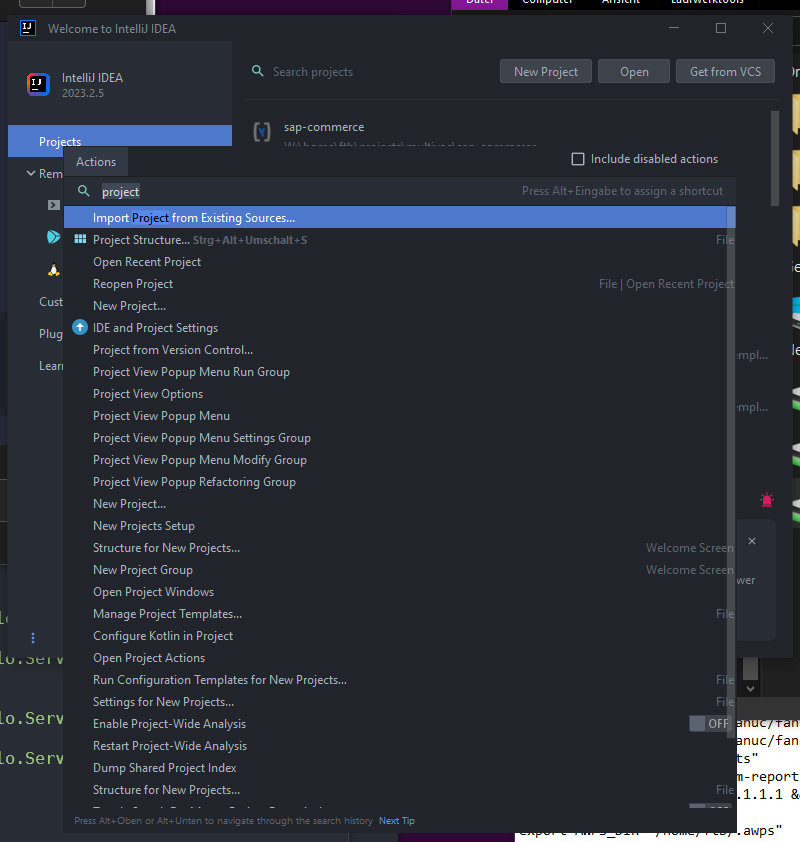

Now select the folder where you cloned the project to and click `OK`.
When using WSL, you must make sure that your path begins with `\\wsl$\`! If your path begins with a drive letter (e.g. `W:`) you are NOT in your WSL workspace and IntelliJ will not recognize the environment as WSL!

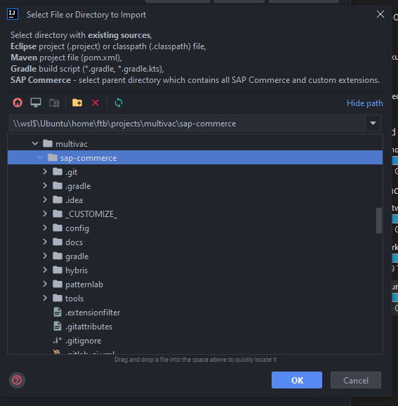

Select `Import project from external model` and choose `SAP Commerce` then click `Next`.

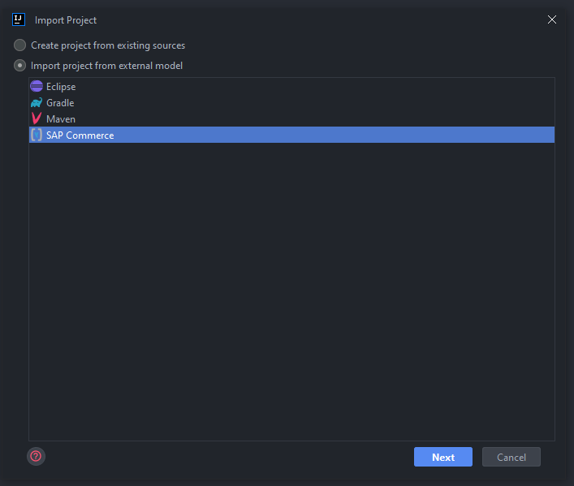

On the following screen just click `Next`.

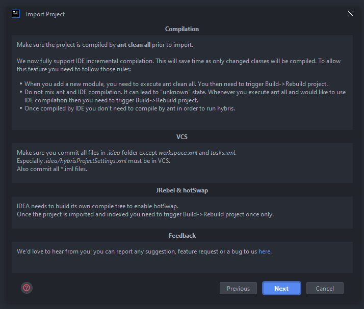

Afterwards you can leave the default settings and click `Next`. Optionally you can change the project name if you want.

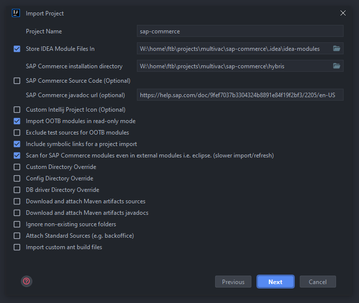

In the extension selection screen, all requried extensions should be preselected like in the screenshot below. If not, you haven't run `gradlew install` yet or there was an issue. If everything is preselected, you can click `Next`.

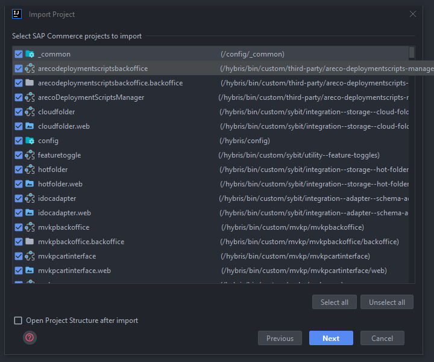

In case where your project contains `.project` files, you will see the next screen with "Other projects" to import. You can leave the default selection and click `Next`.

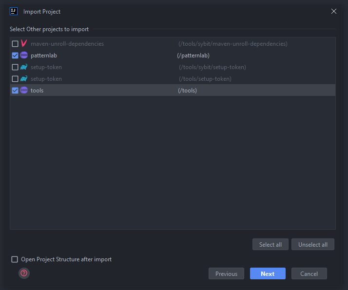

Now you must select the proper SDK for your project. Make sure to select an SDK that is located under `//wsl$/...` if you are using WSL2!
Afterwards click `Create`.

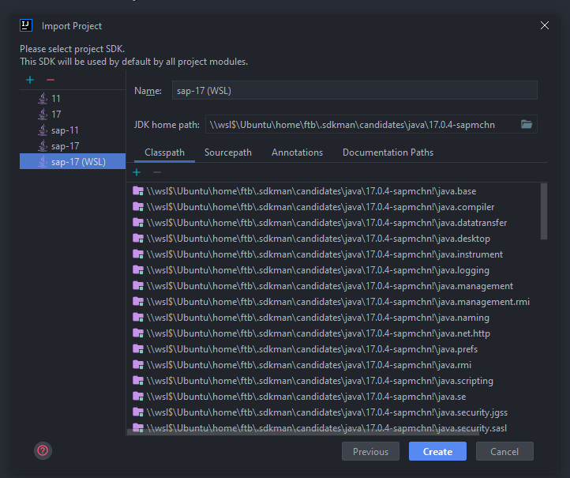

Your project should now be imported, this can take a while. If everything is done you should see a project structure like this:

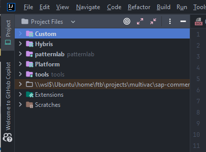

If the following notification appears:

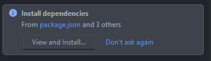

Click `Don't ask again` since we don't want IntelliJ to import any `package.json` files.

## Git Workflow

[↑ To Contents](#table-of-contents)

### Commit Naming Conventions

[↑ To Contents](#table-of-contents)

We use [Conventional Commit](https://www.conventionalcommits.org/en/v1.0.0/#summary) Naming for commit messages.

Examples:

- Implementing new code?
  ```
  feat(SYINNERS-309): added a button to delete issues
  ```
- Fixing an issue in your code?
  ```
  fix(SYINNERS-310): fix the button deleting all issues
  ```
- Refactored with breaking changes?
  ```
  refactor(SYINNERS-311)!: restructured issue API
  ```
- Reformat a file?
  ```
  style(SYINNERS-312): reformat ProductController
  ```
- Updating a maven depdenency?
  ```
  chore(SYINNERS-313): update maven dependency
  ```

**Hint:** Please read conventionalcommits.org for more information. The commit type should be chosen depending on the changes you made in that commit, not based on the type of your Jira Ticket. Conventional Commits and the type of your ticket are **independent** of each other.
_Implementing a new feature does not mean every commit is a `feat` commit! Nor does a bug ticket in Jira mean every commit is a `fix` commit!_

### Branch Naming Conventions

[↑ To Contents](#table-of-contents)

We don't have any specific branch naming conventions, but the following is recommended:

- `feature/<ticket id>/<short description>` for feature branches
- `bugfix/<ticket id>/<short description>` for bugfix branches
- `hotfix/<ticket id>/<short description>` for hotfix branches
- `release/<major.minor>` or `release/<sprint number>` for release branches (this is mandatory for releases as we take the version from the branch name)

It is important that you **DO NOT** include the patch level for release branches, since this is automatically added by the release pipeline.

### Merge Requests

[↑ To Contents](#table-of-contents)

You can configure the merge request settings under [`Settings -> Merge Requests`](/-/settings/merge_requests) in your project sidebar.

#### Merge Request Template

Under the section `Default description template for merge requests` you can define a default template for merge requests. This template will be used for every merge request in your project.
This can also be used to define a default reviewer for merge requests with the `/assign_reviewer` command.

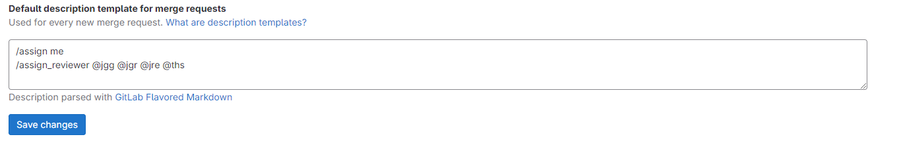

## Hybris Configuration

[↑ To Contents](#table-of-contents)

It is possible to provide different Hybris configurations for single environments (e.g. development/production) or
nodes (e.g. master/slave). Each subdirectory in the `config` directory represents a single configuration.

### Naming conventions

[↑ To Contents](#table-of-contents)

- Environment configurations should have a `env_` prefix
- Node configurations should have a `node_` prefix
- Non-deployment configurations such as the build configuration or inheritance base configurations (see below) have to
  start with a `_` prefix. These configurations are excluded from deployment configurations when building a release.

### Inheritance

[↑ To Contents](#table-of-contents)

For easier maintenance, a single configuration can inherit from another configuration. The inheritance is defined by
a `.parent` file containing the (directory) name of inherited configuration. Each configuration inherits from `_common`
implicitly.

The `local.properties` values will be merged together along the inheritance hierarchy path, overwriting existing values.
Files from a parent configuration will also be overwritten, if they exist.

### Build configuration

[↑ To Contents](#table-of-contents)

Before every project build the Hybris configuration (`hybris/config`) is generated using the configured build
configuration (`_env_local` by default, see Gradle settings).

Single `local.properties` values of the build config may be overridden for local development
with `config/user.properties`.

### IDE configuration

[↑ To Contents](#table-of-contents)

#### Save Actions

[↑ To Contents](#table-of-contents)

Save actions should be configured like this

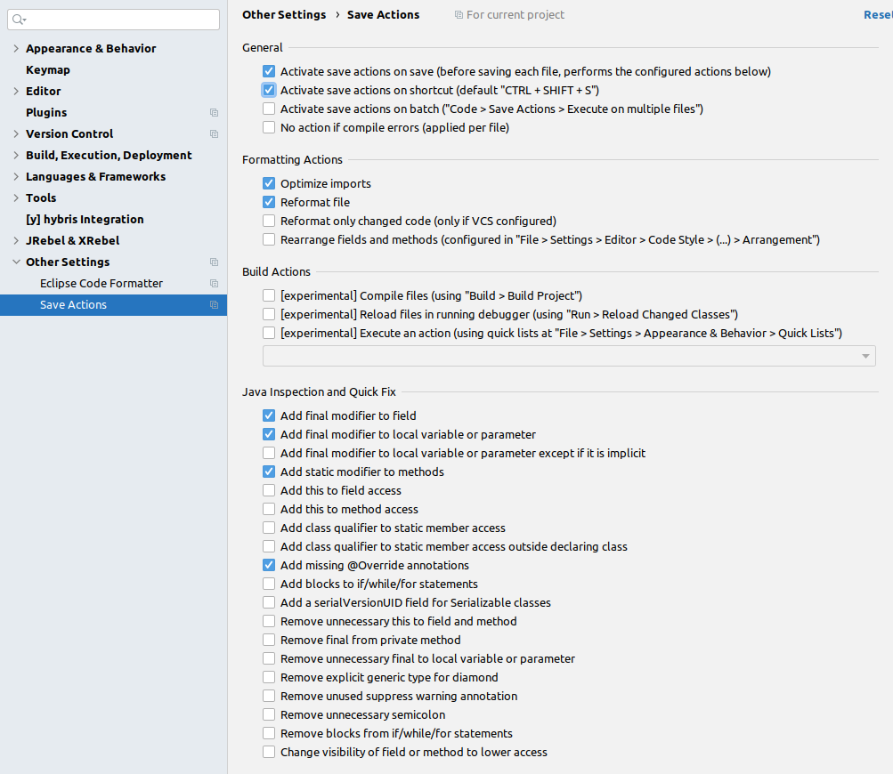

## Usage

[↑ To Contents](#table-of-contents)

### Gradle

#### Settings

[↑ To Contents](#table-of-contents)

The global configuration for the Gradle build (e.g. Extension versions, network proxy, etc.) can be configured
in `gradle.properties`.

#### List all available tasks

[↑ To Contents](#table-of-contents)

To list all available gradle tasks run

**Linux:**

    ./gradlew tasks

**Windows:**

    gradlew tasks

#### Run tasks for a single extension

[↑ To Contents](#table-of-contents)

By default the tasks are run at project scope for all extensions. To run a task for single extension use

**Linux:**

    ./gradlew <task> -Pextension=<extension>

**Windows:**

    gradlew <task> -Pextension=<extension>

#### Build

[↑ To Contents](#table-of-contents)

##### Full build

[↑ To Contents](#table-of-contents)

To build the project run

**Linux:**

    ./gradlew build

**Windows:**

    gradlew build

It will automatically install all dependencies, compile the sources and refresh the server config.

##### Clean rebuild

[↑ To Contents](#table-of-contents)

**Linux:**

    ./gradlew clean build

**Windows:**

    gradlew clean build

_⚠ Use this only if you know what you are doing since it's **really** time expensive ⚠_

#### Recompile

[↑ To Contents](#table-of-contents)

For usage with JRebel you can recompile the sources with

**Linux:**

    ./gradlew compile

**Windows:**

    gradlew compile

**🚀 Performance hint:** Use `./gradlew compile -Pextension=<extension>` to compile only a modified extension and save
time.

#### Initialize

[↑ To Contents](#table-of-contents)

To get a freshly initialized system you may use the following command, after a clean build

**Linux:**

    ./gradlew initialize

**Windows:**

    gradlew initialize

This will start the server to initialize the database and shuts it down afterwards.

#### Tests

[↑ To Contents](#table-of-contents)

To run unit and web tests use:

**Linux:**

    ./gradlew test

**Windows:**

    gradlew test

##### Package restriction

[↑ To Contents](#table-of-contents)

The executed tests are restricted by package name and can be configured globally in `gradle.properties` or at runtime
with

**Linux:**

    ./gradlew test -Ptestclasses.packages=mypackage.*

**Windows:**

    gradlew test -Ptestclasses.packages=mypackage.*

##### Web tests

[↑ To Contents](#table-of-contents)

To run tests located in `web/testsrc` use

**Linux:**

    ./gradlew test -Ptestclasses.web=true

**Windows:**

    gradlew test -Ptestclasses.web=true

##### Test Report directory

[↑ To Contents](#table-of-contents)

To configure a custom report directory use

**Linux:**

    ./gradlew test -Ptestclasses.reportdir=<directory path>

**Windows:**

    gradlew test -Ptestclasses.reportdir=<directory path>

#### Create releases

[↑ To Contents](#table-of-contents)

To create a release run

**Linux:**

    ./gradlew release

**Windows:**

    gradlew release

#### Start Hybris

[↑ To Contents](#table-of-contents)

To start Hybris server in debug mode run

**Linux:**

    ./hybrisserver.sh debug

**Windows:**

    hybrisserver.bat debug

#### Refresh server config

[↑ To Contents](#table-of-contents)

To refresh the server config run

**Linux:**

    ./gradlew server

**Windows:**

    gradlew server

#### Optional: Unzip filter

[↑ To Contents](#table-of-contents)

**This filter file can only be created AFTER the project has been installed once.**

Once all extensions are configured in the `localextensions.xml` use the built-in unzip filter to prevent a full unzip of
the Hybris distribution during installation, thus saving a lot of time. To create the required config file run

**Linux:**

    ./gradlew writeExtensionFilterFile

**Windows:**

    gradlew writeExtensionFilterFile

The unzip filter can also be deactivated in the `gradle.properties` by setting `hybrisUnzipFilterEnabled` to `false`.
